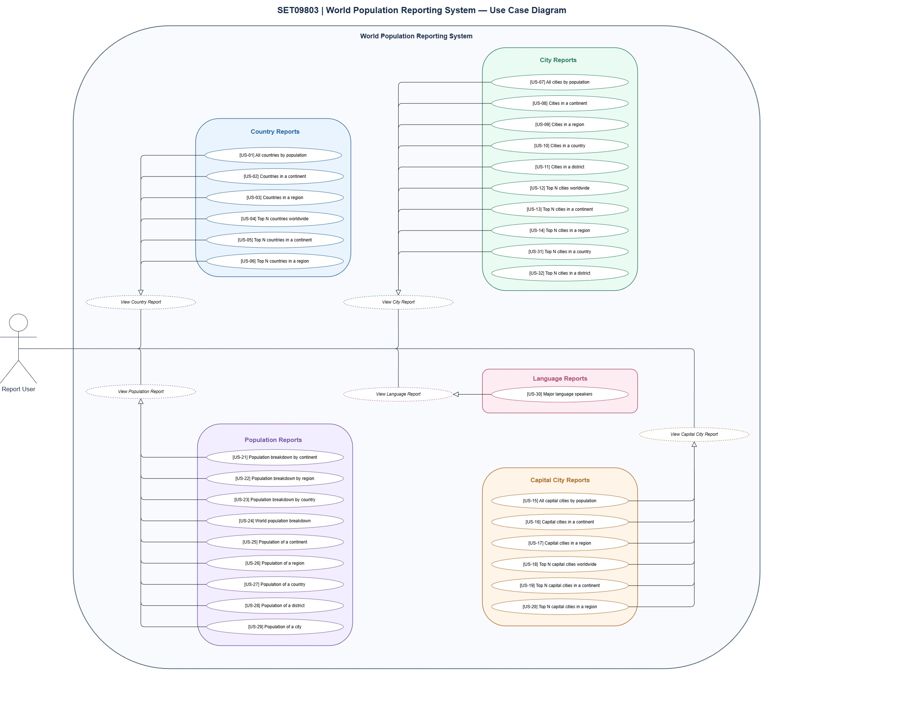

# SET09803 DevOps Group 1

A population reporting system developed using Java, Maven, MySQL, Docker and GitHub Actions.

The application generates reports on countries, cities, capital cities, population statistics and languages using the MySQL `world` database.

The project follows Scrum and DevOps practices to support collaborative development, continuous integration and version control.

## Build Status and Release

[](https://github.com/shinehtet-codes/SET09803-DevOps-Group-1/actions/workflows/main.yml?query=branch%3Amaster)

[](https://github.com/shinehtet-codes/SET09803-DevOps-Group-1/actions/workflows/main.yml?query=branch%3Adevelop)

[](https://github.com/shinehtet-codes/SET09803-DevOps-Group-1/releases)

[](https://github.com/shinehtet-codes/SET09803-DevOps-Group-1/blob/master/LICENSE)

## Technologies

- Java 25
- Apache Maven
- MySQL
- Docker
- Docker Compose
- Git
- GitHub
- GitHub Actions

## Development Methodology

The project follows the Scrum framework. Tasks and requirements are managed using GitHub Issues, a product backlog and a Kanban board.

The team uses GitFlow-style branching, feature branches and pull requests to manage development and integration.

## Use Case Diagram

The use case diagram illustrates the interaction between the report user and the World Population Reporting System.

It contains 32 reporting use cases organised into five categories:

- Country Reports
- City Reports
- Capital City Reports
- Population Reports
- Language Reports

[View Use Case Diagram](docs/diagrams/SET09803_Group_1l_Use_Case_Diagram.jpg)



Detailed use case descriptions are available in the [Use Cases](use-cases/) directory.

## Report Requirements and Evidence

The following tables list all 32 reporting requirements and provide links to their corresponding output screenshots.

**Met** indicates whether screenshot evidence has been provided for the requirement. Functional correctness is assessed separately through testing.

### Country Reports

| ID | Name | Met | Screenshot |
|---|---|---|---|
| US-01 | All the countries in the world organised by largest population to smallest. | Yes | [image](docs/evidences/reports/US-01.png) |
| US-02 | All the countries in a continent organised by largest population to smallest. | Yes | [image](docs/evidences/reports/US-02.png) |
| US-03 | All the countries in a region organised by largest population to smallest. | Yes | [image](docs/evidences/reports/US-03.png) |
| US-04 | The top N populated countries in the world, where N is provided by the user. | Yes | [image](docs/evidences/reports/US-04.png) |
| US-05 | The top N populated countries in a continent, where N is provided by the user. | Yes | [image](docs/evidences/reports/US-05.png) |
| US-06 | The top N populated countries in a region, where N is provided by the user. | Yes | [image](docs/evidences/reports/US-06.png) |

### City Reports

| ID | Name | Met | Screenshot |
|---|---|---|---|
| US-07 | All the cities in the world organised by largest population to smallest. | Yes | [image](docs/evidences/reports/US-07.png) |
| US-08 | All the cities in a continent organised by largest population to smallest. | Yes | [image](docs/evidences/reports/US-08.png) |
| US-09 | All the cities in a region organised by largest population to smallest. | Yes | [image](docs/evidences/reports/US-09.png) |
| US-10 | All the cities in a country organised by largest population to smallest. | Yes | [image](docs/evidences/reports/US-10.png) |
| US-11 | All the cities in a district organised by largest population to smallest. | Yes | [image](docs/evidences/reports/US-11.png) |
| US-12 | The top N populated cities in the world, where N is provided by the user. | Yes | [image](docs/evidences/reports/US-12.png) |
| US-13 | The top N populated cities in a continent, where N is provided by the user. | Yes | [image](docs/evidences/reports/US-13.png) |
| US-14 | The top N populated cities in a region, where N is provided by the user. | Yes | [image](docs/evidences/reports/US-14.png) |
| US-31 | The top N populated cities in a country, where N is provided by the user. | Yes | [image](docs/evidences/reports/US-31.png) |
| US-32 | The top N populated cities in a district, where N is provided by the user. | Yes | [image](docs/evidences/reports/US-32.png) |

### Capital City Reports

| ID | Name | Met | Screenshot |
|---|---|---|---|
| US-15 | All the capital cities in the world organised by largest population to smallest. | Yes | [image](docs/evidences/reports/US-15.png) |
| US-16 | All the capital cities in a continent organised by largest population to smallest. | Yes | [image](docs/evidences/reports/US-16.png) |
| US-17 | All the capital cities in a region organised by largest population to smallest. | Yes | [image](docs/evidences/reports/US-17.png) |
| US-18 | The top N populated capital cities in the world, where N is provided by the user. | Yes | [image](docs/evidences/reports/US-18.png) |
| US-19 | The top N populated capital cities in a continent, where N is provided by the user. | Yes | [image](docs/evidences/reports/US-19.png) |
| US-20 | The top N populated capital cities in a region, where N is provided by the user. | Yes | [image](docs/evidences/reports/US-20.png) |

### Population Reports

| ID | Name | Met | Screenshot |
|---|---|---|---|
| US-21 | The population of people, people living in cities, and people not living in cities in each continent, including percentages. | Yes | [image](docs/evidences/reports/US-21.png) |
| US-22 | The population of people, people living in cities, and people not living in cities in each region, including percentages. | Yes | [image](docs/evidences/reports/US-22.png) |
| US-23 | The population of people, people living in cities, and people not living in cities in each country, including percentages. | Yes | [image](docs/evidences/reports/US-23.png) |
| US-24 | The total population of the world, including the city and non-city population breakdown. | Yes | [image](docs/evidences/reports/US-24.png) |
| US-25 | The population of a continent. | Yes | [image](docs/evidences/reports/US-25.png) |
| US-26 | The population of a region. | Yes | [image](docs/evidences/reports/US-26.png) |
| US-27 | The population of a country. | Yes | [image](docs/evidences/reports/US-27.png) |
| US-28 | The population of a district. | Yes | [image](docs/evidences/reports/US-28.png) |
| US-29 | The population of a city. | Yes | [image](docs/evidences/reports/US-29.png) |

### Language Reports

| ID | Name | Met | Screenshot |
|---|---|---|---|
| US-30 | The number of people speaking Chinese, English, Hindi, Spanish and Arabic, organised by number of speakers, including their percentage of the world population. | Yes | [image](docs/evidences/reports/US-30.png) |

## Running the Application

Ensure Docker Desktop is running before executing the following commands from the project root.

### 1. Start the database

```bash
docker compose up -d db
```

### 2. Build the application

```bash
mvn clean package
```

### 3. Run the application

```bash
docker compose run --rm --build app
```

The application provides an interactive console menu that allows users to select a report category, choose a report and enter the required parameters.

## Team

| Member | Role |
|---|---|
| Shine Htet | Scrum Master |
| Hla Min Phyo | Product Owner |
| Zin Nwe Tun | Developer |
| Aye Pyae Thu | Developer |
| May Thu Zaw | Developer |
| Thin Nadi Oo | Developer |

## Project Status

**In Development**

All 32 reporting requirements have corresponding screenshot evidence in the repository.

Continuous integration is managed through GitHub Actions, with separate build status badges for the `master` and `develop` branches.

Automated test coverage reporting will be addressed in the next development phase.
